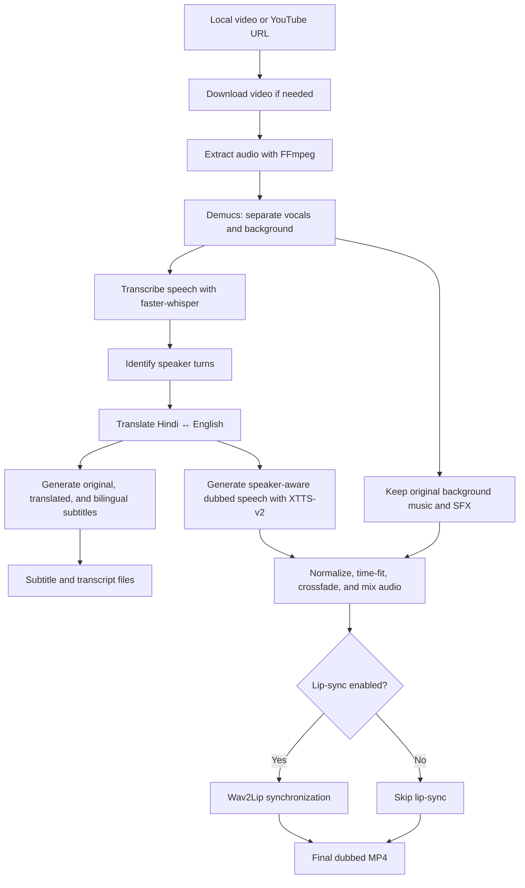

<!-- # 🎙️ EchoLocal: Open-Source AI Video Dubbing, Multi-Speaker Voice Cloning & Lip-Sync Pipeline

[](https://www.python.org/)
[](https://pytorch.org/)
[](https://streamlit.io/)
[](LICENSE)

**EchoLocal** is a production-grade, open-source AI video localization & dubbing pipeline. It automatically translates and dubs videos between **Hindi** and **English** (bi-directional), preserves original background music & sound effects (SFX), performs multi-speaker identification, generates timestamped `.srt` subtitles, and synchronizes lip movements.

Engineered for high performance, low VRAM consumption (optimized for 6GB GPUs like NVIDIA GeForce RTX 3050), and 100% crash-proof execution.

---

## 🌟 Key Features

- ▶️ **YouTube URL Integration**: Paste any YouTube video, Short, or Live stream URL (`yt-dlp`) for auto-download and dubbing at up to 1080p max resolution.
- ⚡ **GPU-Accelerated & Low VRAM**: PyTorch CUDA 12.4 acceleration with sequential model lifecycle management and VRAM auto-cleanup (runs smoothly on 6GB VRAM GPUs).
- 🎵 **Demucs Vocal & Background Separation**: Uses Meta's `htdemucs` to isolate speech from background music & SFX for crisp transcription and audio preservation.
- 🎙️ **Faster-Whisper STT**: High-precision speech-to-text recognition with CTranslate2 float16 GPU acceleration.
- 👥 **Hybrid Speaker Diarization**: Multi-speaker identification via Pyannote 3.1 + an automatic **Librosa MFCC + Pitch (F0) + KMeans Acoustic Feature Clustering** fallback (works out of the box without requiring a Hugging Face token!).
- 🌐 **Conversational Translation**: Integrated with `Helsinki-NLP` (`opus-mt-en-hi` & `opus-mt-hi-en`) & `NLLB-200` with an **Adaptation Post-Processing Pass** that refines literal machine translation into natural, colloquial conversational Hindi/English.
- 🗣️ **Coqui XTTS-v2 Zero-Shot Voice Cloning**: Clones speaker-specific voices directly on **Python 3.13** using 6–10 second clean reference audio clips extracted per speaker.
- 🎚️ **Loudness Normalization & 75ms Crossfading**: FFmpeg `loudnorm` filter (-16 LUFS) per segment + 75ms boundary crossfading to eliminate volume jumps, audio clipping, and multi-speaker overlap disturbance.
- 🎶 **Transparent Background Music Ducking**: Preserves original background music and SFX with dynamic sidechain ducking so background audio stays audible throughout the video.
- 📜 **Multi-Format Subtitles**: Auto-generates `.srt` subtitle files in **Original**, **Translated**, and **Bilingual (Dual-Language Stacked)** formats.
- 💋 **Wav2Lip Lip-Syncing**: VRAM-safe 10-second chunked lip synchronization with `--skip-lipsync` bypass mode.
- 💻 **Streamlit GUI & CLI Batch Processing**: Interactive Web UI (`app.py`) + single video & batch directory CLI commands (`run_pipeline.py`).

---

## 🔄 End-to-End Pipeline Architecture

```text
       ┌─────────────────────────────────────────────────────────┐
       │   Input Source: Local Video File OR YouTube Video URL   │
       └────────────────────────────┬────────────────────────────┘
                                    │
                                    ▼ (Step 0: download_youtube.py / yt-dlp)
                      [input/<video_name>.mp4] (1080p max)
                                    │
                                    ▼ (Step 1: extract_audio.py)
                      [temp/<video_name>.wav] (16kHz Mono)
                                    │
                                    ▼ (Step 2: separate_audio.py - Demucs htdemucs)
            ┌───────────────────────┴───────────────────────┐
            │                                               │
            ▼ Vocals Track                                  ▼ Background Track (Music + SFX)
  [temp/separated/vocals.wav]                      [temp/separated/background.wav]
            │                                               │
            ▼ (Step 3: transcribe.py - faster-whisper GPU)  │
  [output/vocals.json]                                      │
            │                                               │
            ▼ (Step 4: diarize.py - Pyannote / Acoustic)    │
  [output/vocals_diarized.json (Multi-Speaker Tags)]        │
            │                                               │
            ▼ (Step 5: translate.py + Conversational Pass) │
  [output/vocals_diarized_translated.json]                │
            │                                               │
            ├───────────────────────────────────────────────┤
            │ (Step 6: generate_subtitles.py)               │
            ▼                                               │
  [.srt Subtitles: Original, Translated, Bilingual]         │
            │                                               │
            ▼ (Step 7: voice_clone_tts.py - Coqui XTTS-v2)  │
  [temp/tts_segments/segment_0000.wav (-16 LUFS)]          │
            │                                               │
            └───────────────────────┬───────────────────────┘
                                    │
                                    ▼ (Step 8: merge_final.py)
              [Audio Speed-Sync + 75ms Crossfade + Demucs BG Ducking]
                                    │
                  [temp/full_dubbed_audio.wav]
                                    │
                                    ▼ (Step 9: lip_sync.py - Wav2Lip 10s Chunks)
                                    │
                    ┌───────────────┴───────────────┐
                    │      Final Output Video       │
                    │  (output/<video>_dubbed.mp4)  │
                    └───────────────────────────────┘
```

---

## 🛠️ Module Breakdown

| Module | File Path | Key Technology & Role |
|---|---|---|
| **YouTube Downloader** | [src/download_youtube.py](file:///F:/Echolocal/src/download_youtube.py) | Downloads YouTube videos/Shorts via `yt-dlp` at max 1080p resolution with safe filename sanitization and error handling. |
| **Audio Extractor** | [src/extract_audio.py](file:///F:/Echolocal/src/extract_audio.py) | Extracts 16kHz mono PCM WAV audio using FFmpeg. Auto-locates system FFmpeg. |
| **Audio Separator** | [src/separate_audio.py](file:///F:/Echolocal/src/separate_audio.py) | Separates audio into `vocals.wav` (speech) and `background.wav` (music & SFX) using Meta Demucs (`htdemucs`). |
| **Speech Transcriber** | [src/transcribe.py](file:///F:/Echolocal/src/transcribe.py) | Transcribes speech to text with timestamps using `faster-whisper` (CTranslate2 CUDA float16). |
| **Speaker Diarizer** | [src/diarize.py](file:///F:/Echolocal/src/diarize.py) | Diarizes multi-speaker turns (`SPEAKER_00`, `SPEAKER_01`) via Pyannote 3.1 with Librosa MFCC + Pitch KMeans fallback. |
| **Translator** | [src/translate.py](file:///F:/Echolocal/src/translate.py) | Translates Hindi↔English (Helsinki-NLP / NLLB-200) + Conversational Adaptation post-processing pass. |
| **Subtitle Generator**| [src/generate_subtitles.py](file:///F:/Echolocal/src/generate_subtitles.py) | Generates Original, Translated, and Bilingual stacked `.srt` subtitle files. |
| **Voice Clone TTS** | [src/voice_clone_tts.py](file:///F:/Echolocal/src/voice_clone_tts.py) | Zero-shot voice cloning with **Coqui XTTS-v2** + Edge-TTS fallback + Punctuation pre-processing + `-16 LUFS` loudnorm. |
| **Audio Synchronizer**| [src/merge_final.py](file:///F:/Echolocal/src/merge_final.py) | Syncs speech segment speeds (`atempo` 0.85x–1.30x), applies 75ms crossfades, mixes background track, and muxes video. |
| **Lip Synchronizer** | [src/lip_sync.py](file:///F:/Echolocal/src/lip_sync.py) | Synchronizes speaker lip movements with dubbed audio using Wav2Lip with 10-second chunking. |
| **GPU Manager** | [src/gpu_utils.py](file:///F:/Echolocal/src/gpu_utils.py) | Manages CUDA VRAM memory cleanup (`clear_vram()`), auto-detects FFmpeg binary, and handles OOM exceptions. |

---

## 💻 Setup & Installation

### 1. Requirements
- **Operating System**: Windows 10/11 or Linux
- **GPU**: NVIDIA GPU with 6GB+ VRAM (e.g., RTX 3050, RTX 3060, RTX 4060, T4)
- **Python**: 3.10, 3.11, or 3.13
- **FFmpeg**: Must be installed or available in `C:\ffmpeg\`

### 2. Installation Steps

```bash
# Clone repository
git clone https://github.com/your-username/EchoLocal.git
cd EchoLocal

# Create and activate virtual environment
python -m venv venv

# PowerShell (Windows)
.\venv\Scripts\Activate.ps1

# Install dependencies (with PyTorch CUDA 12.4 support)
pip install -r requirements.txt
```

### 3. Verify GPU Acceleration

```bash
python test_gpu.py
```
> **Expected Output**: `CUDA Available: True | GPU 0: NVIDIA GeForce RTX 3050 6GB Laptop GPU`

---

## 🚀 How to Run

### Option 1: Streamlit Web Interface (Recommended)

Launch the interactive Web GUI:

```bash
streamlit run app.py
```
Open **`http://localhost:8501`** in your web browser.
- Select between **📁 Local File Upload** or **▶️ YouTube URL**.
- Choose source/target languages and feature toggles (Voice Cloning, Background Music, Lip-Sync).
- Click **🚀 Start Dubbing Pipeline** to run the complete pipeline and preview/download results.

### Option 2: CLI — Process Local Video

```bash
python run_pipeline.py --video input/sample_video.mp4
```

### Option 3: CLI — Download & Process YouTube URL

```bash
python run_pipeline.py --youtube-url "https://www.youtube.com/watch?v=dQw4w9WgXcQ" --max-height 1080
```

### Option 4: CLI — Fast Preview (Skip Lip-Sync)

```bash
python run_pipeline.py --video input/sample_video.mp4 --skip-lipsync
```

### Option 5: CLI — Batch Folder Processing

Place multiple videos in `input/` folder and process all at once:

```bash
python run_pipeline.py --batch-dir input/
```

---

## 📂 Project Directory Structure

```text
EchoLocal/
├── app.py                   # Streamlit Web Application
├── run_pipeline.py          # Master CLI Orchestrator (Single & Batch Mode)
├── test_gpu.py              # GPU Verification Script
├── requirements.txt         # Dependency Manifest
├── README.md                # Documentation
├── .streamlit/
│   └── config.toml          # Streamlit UI Configuration
├── input/                   # Input video files (.mp4, .mkv, .mov)
├── output/                  # Final dubbed videos, .SRT subtitles & JSON transcripts
├── temp/                    # Temporary audio cache, separated tracks & segment WAVs
└── src/
    ├── download_youtube.py  # YouTube Video Downloader (yt-dlp)
    ├── extract_audio.py     # Step 1: FFmpeg Audio Extractor
    ├── separate_audio.py    # Step 2: Demucs Vocals & Background Separator
    ├── transcribe.py        # Step 3: faster-whisper STT
    ├── diarize.py           # Step 4: Pyannote / Acoustic Feature Diarizer
    ├── translate.py         # Step 5: Helsinki-NLP / NLLB + Conversational Adaptation
    ├── generate_subtitles.py# Step 6: Subtitle Generator (.srt)
    ├── voice_clone_tts.py   # Step 7: Coqui XTTS-v2 Speech Generator
    ├── merge_final.py       # Step 8: Audio Speed Sync, Crossfade & Music Mixer
    ├── lip_sync.py          # Step 9: Wav2Lip Lip-Synchronizer
    └── gpu_utils.py         # GPU VRAM Tracker, clear_vram(), CUDA OOM Handler
```

---

## 📄 Output Artifacts

All final generated outputs are saved in `output/`:

- 🎥 **Final Dubbed Video**: `output/<video_name>_dubbed.mp4`
- 📜 **Original Subtitles**: `output/<video_name>_original.srt`
- 📜 **Translated Subtitles**: `output/<video_name>_translated.srt`
- 📜 **Bilingual Subtitles**: `output/<video_name>_bilingual.srt`
- 📄 **Transcript JSON**: `output/vocals_diarized_translated.json`

---

## 🤝 Contributing

Contributions are welcome! Please feel free to submit a Pull Request or open an Issue for bug reports, feature suggestions, or translation model support for additional languages.

---

## 📜 License

This project is open-source under the **MIT License**. See the [LICENSE](LICENSE) file for details. -->


<div align="center">

# 🎙️ EchoLocal

### Local-first AI video dubbing, speaker-aware voice cloning, and lip synchronization

Translate dialogue between **Hindi ↔ English**, generate dubbed speech, preserve the original soundtrack, and export subtitles and a finished video from a local file or a supported YouTube URL.

<p>
  <a href="https://www.python.org/"></a>
  <a href="https://pytorch.org/"></a>
  <a href="https://streamlit.io/"></a>
  
  <a href="LICENSE"></a>
</p>

</div>

---

## 📌 Table of contents

- [What is EchoLocal?](#-what-is-echolocal)
- [Features](#-features)
- [How it works](#-how-it-works)
- [Technology stack](#-technology-stack)
- [Requirements](#-requirements)
- [Installation](#-installation)
- [Run EchoLocal](#-run-echolocal)
- [Output files](#-output-files)
- [Project structure](#-project-structure)
- [Troubleshooting](#-troubleshooting)
- [Responsible use](#-responsible-use)
- [Contributing](#-contributing)
- [License](#-license)

## 🎯 What is EchoLocal?

**EchoLocal** is an open-source video localization pipeline that turns a video's dialogue into a Hindi or English dub while keeping the video's broader audio context. It combines speech recognition, speaker diarization, translation, voice cloning, subtitle generation, audio mixing, and optional lip synchronization into one workflow.

The project is designed to manage GPU memory carefully, including sequential model use and VRAM cleanup. Its target setup includes NVIDIA GPUs with around **6 GB of VRAM**, such as an RTX 3050; actual speed and memory use depend on the input, models, and enabled features.

## ✨ Features

| Capability | What it does |
|---|---|
| 🎬 **Video input** | Process a local video or download a supported YouTube video/Short using `yt-dlp` (up to 1080p as configured). |
| 🎵 **Voice/background separation** | Uses Demucs `htdemucs` to separate speech vocals from background music and sound effects. |
| 📝 **Speech recognition** | Uses `faster-whisper` to produce a transcript with timestamps. |
| 👥 **Speaker diarization** | Uses Pyannote Audio 3.1 when available, with a Librosa MFCC/pitch feature-clustering fallback. The fallback is an estimate, not a guarantee of perfect speaker separation. |
| 🌐 **Hindi ↔ English translation** | Uses Helsinki-NLP translation models and/or NLLB-200, followed by conversational adaptation post-processing. |
| 🗣️ **Speaker-aware voice cloning** | Uses Coqui XTTS-v2 with approximately 6–10 seconds of clean reference speech per speaker; an Edge-TTS fallback is included. |
| 🎚️ **Audio finishing** | Normalizes generated segments toward `-16 LUFS`, applies 75 ms crossfades, adjusts segment speed, and mixes the original background track with ducking. |
| 📜 **Subtitle generation** | Exports original-language, translated, and stacked bilingual `.srt` subtitles. |
| 💋 **Lip synchronization** | Uses Wav2Lip in 10-second chunks; disable this step for a faster preview with `--skip-lipsync`. |
| 🖥️ **Web UI and CLI** | Run the Streamlit interface, process a single file, download/process a YouTube URL, or run a directory batch. |
| ⚡ **GPU memory management** | Includes CUDA checks, VRAM cleanup, FFmpeg detection, and handling for out-of-memory errors. |

> **Scope:** The documented translation workflow is Hindi ↔ English. Results vary with recording quality, background noise, overlapping speech, translation context, and voice-reference quality.

## 🔄 How it works



### Pipeline stages

1. **Prepare media:** Download the source when using a YouTube URL, then extract mono 16 kHz audio.
2. **Separate and understand speech:** Demucs separates vocals from background audio; `faster-whisper` transcribes speech and the diarization module labels speaker turns.
3. **Translate and subtitle:** Translate the transcript and create timestamped `.srt` files in the available subtitle formats.
4. **Create the dub:** Generate speech with the selected TTS path, then normalize and time-fit audio segments.
5. **Rebuild the video:** Mix dubbed speech with the original background track, then optionally run Wav2Lip before saving the final video.

## 🧰 Technology stack

| Component | Technology | Role |
|---|---|---|
| Video download | `yt-dlp` | Retrieves supported YouTube sources. |
| Media processing | FFmpeg | Extracts audio, applies audio filters, and muxes video/audio. |
| Audio separation | Demucs `htdemucs` | Separates vocals and background audio. |
| Speech-to-text | `faster-whisper` / CTranslate2 | Produces transcript text and timestamps. |
| Speaker diarization | Pyannote Audio 3.1; Librosa + KMeans fallback | Estimates who spoke when. |
| Translation | Helsinki-NLP MarianMT; NLLB-200 | Translates dialogue between Hindi and English. |
| Text-to-speech | Coqui XTTS-v2; Edge-TTS fallback | Generates dubbed speech using speaker reference audio when supported by the active path. |
| Lip synchronization | Wav2Lip | Aligns mouth movements to the dubbed audio. |
| User interface | Streamlit | Provides an interactive browser-based interface. |
| GPU runtime | PyTorch / CUDA | Accelerates compatible workloads on NVIDIA GPUs. |

## 💻 Requirements

- **Operating system:** Windows 10/11 or Linux.
- **Python:** 3.10, 3.11, or 3.13, as specified by this project's current setup. Dependency compatibility can vary by Python version.
- **GPU:** NVIDIA GPU with 6 GB or more of VRAM is the target configuration. Model availability and performance depend on your hardware and installed PyTorch/CUDA build.
- **FFmpeg:** Install FFmpeg and make sure `ffmpeg` is available on your `PATH`. The project may also look in `C:\ffmpeg\` on Windows.
- **Git:** Required to clone the repository.
- **Disk space and internet:** Allow room for Python packages, model weights, temporary audio segments, and generated videos. Internet is needed to clone the repository and may be needed to download video sources or model assets.

## 📦 Installation

### 1. Clone the repository

Replace `YOUR_USERNAME` and `YOUR_REPOSITORY` with the owner and repository name from your GitHub URL before running these commands.

```bash
git clone https://github.com/YOUR_USERNAME/YOUR_REPOSITORY.git
cd YOUR_REPOSITORY
```

### 2. Create and activate a virtual environment

**Windows PowerShell**

```powershell
python -m venv .venv
.\.venv\Scripts\Activate.ps1
```

If PowerShell blocks activation, use a terminal where script activation is permitted or follow your system's Python environment policy.

**Linux**

```bash
python3 -m venv .venv
source .venv/bin/activate
```

### 3. Install dependencies

```bash
python -m pip install --upgrade pip
pip install -r requirements.txt
```

The project requirements are intended to install the required Python dependencies, including the configured PyTorch/CUDA stack. Follow the PyTorch installation guidance if your installed environment does not detect your NVIDIA GPU.

### 4. Verify GPU availability

```bash
python test_gpu.py
```

The script should report whether CUDA is available and, when detected, the GPU name. For example, a compatible setup may report an NVIDIA GeForce RTX 3050 Laptop GPU. Your output will reflect your own hardware and installation.

## 🚀 Run EchoLocal

### Option A — Streamlit web interface

This is the recommended way to explore the available controls.

```bash
streamlit run app.py
```

Open **http://localhost:8501** in your browser. In the interface:

1. Choose a local video or a YouTube URL.
2. Select the source and target languages.
3. Configure available options such as voice cloning, background music, and lip synchronization.
4. Start the pipeline, then preview or download the generated results.

### Option B — Process a local video

```bash
python run_pipeline.py --video input/sample_video.mp4
```

Replace `input/sample_video.mp4` with the path to your video.

### Option C — Download and process a YouTube URL

```bash
python run_pipeline.py --youtube-url "https://www.youtube.com/watch?v=dQw4w9WgXcQ" --max-height 1080
```

Replace the example URL with a video you are allowed to access and process. Download availability depends on YouTube and `yt-dlp` support.

### Option D — Skip lip synchronization for a faster preview

```bash
python run_pipeline.py --video input/sample_video.mp4 --skip-lipsync
```

This bypasses the Wav2Lip stage; the resulting video will not have the lip-sync adjustment from that stage.

### Option E — Batch-process a directory

Place the videos you want to process in a directory, then run:

```bash
python run_pipeline.py --batch-dir input/
```

## 📄 Output files

Generated artifacts are saved under `output/` according to the source name and pipeline configuration.

| Artifact | Typical path | Description |
|---|---|---|
| 🎥 Dubbed video | `output/<video_name>_dubbed.mp4` | Final video with the generated dub; lip synchronization depends on whether that stage is enabled. |
| 📝 Original subtitles | `output/<video_name>_original.srt` | Timestamped subtitles in the source language. |
| 🌐 Translated subtitles | `output/<video_name>_translated.srt` | Timestamped subtitles in the target language. |
| 🌍 Bilingual subtitles | `output/<video_name>_bilingual.srt` | Stacked source-language and target-language subtitles. |
| 📊 Transcript data | `output/vocals_diarized_translated.json` | Structured diarized and translated transcript data. |

Intermediate files such as extracted audio, separated tracks, and TTS segments are kept under `temp/` and related working directories during processing.

## 🗂️ Project structure

```text
EchoLocal/
├── app.py                       # Streamlit web interface
├── run_pipeline.py              # Single-video and batch CLI orchestration
├── test_gpu.py                  # GPU/CUDA verification
├── requirements.txt             # Python dependencies
├── README.md                    # Project documentation
├── LICENSE                      # Project license
├── .streamlit/
│   └── config.toml               # Streamlit configuration
├── input/                        # Input videos
├── output/                       # Final videos, subtitles, and transcript files
├── temp/                         # Intermediate audio and TTS segments
└── src/
    ├── download_youtube.py       # YouTube source download
    ├── extract_audio.py          # FFmpeg audio extraction
    ├── separate_audio.py         # Demucs vocal/background separation
    ├── transcribe.py             # Speech recognition
    ├── diarize.py                # Speaker diarization and fallback clustering
    ├── translate.py              # Hindi-English translation and adaptation
    ├── generate_subtitles.py     # SRT subtitle generation
    ├── voice_clone_tts.py        # Voice-cloned speech generation
    ├── merge_final.py            # Timing, audio mixing, and video muxing
    ├── lip_sync.py               # Wav2Lip lip synchronization
    └── gpu_utils.py              # GPU memory and FFmpeg utilities
```

### Module reference

| Module | Main responsibility |
|---|---|
| `src/download_youtube.py` | Downloads supported YouTube videos and sanitizes filenames. |
| `src/extract_audio.py` | Extracts audio to 16 kHz mono WAV using FFmpeg. |
| `src/separate_audio.py` | Creates vocal and background tracks using Demucs. |
| `src/transcribe.py` | Transcribes speech and records timestamps. |
| `src/diarize.py` | Labels speaker turns with Pyannote or acoustic-feature clustering. |
| `src/translate.py` | Translates transcript segments and applies conversational adaptation. |
| `src/generate_subtitles.py` | Generates original, translated, and bilingual SRT files. |
| `src/voice_clone_tts.py` | Produces the dubbed speech with XTTS-v2 and a fallback TTS path. |
| `src/merge_final.py` | Fits segment timing, applies crossfades and loudness normalization, and mixes the soundtrack. |
| `src/lip_sync.py` | Runs chunked lip synchronization with Wav2Lip. |
| `src/gpu_utils.py` | Handles GPU memory cleanup and FFmpeg discovery utilities. |

## 🛠️ Troubleshooting

### `ffmpeg` is not found

Run `ffmpeg -version` in the same terminal you use to launch EchoLocal. If the command fails, install FFmpeg and add its executable directory to your `PATH` (or place it in the location your local setup expects).

### CUDA is unavailable

Run `python test_gpu.py` and check that your NVIDIA driver and installed PyTorch build support the CUDA environment you intend to use. A PyTorch package that does not match your environment may prevent GPU acceleration from being detected.

### CUDA out-of-memory errors

Close other GPU-intensive applications, try a shorter input, or run a preview with `--skip-lipsync`. The pipeline includes memory-management helpers, but not every model and video will fit within every GPU's available VRAM.

### Speaker labels or dubbing sound incorrect

Speaker diarization, translation, and cloned speech are model-generated estimates. Results are more likely to degrade with overlapping dialogue, noisy recordings, very short speaker turns, or unclear reference audio. Review the output before publishing it.

## 🔐 Responsible use

- Use videos and voice references that you own or have permission to process.
- Respect the source platform's terms, copyright, privacy, and applicable laws when downloading or transforming media.
- Disclose AI-generated or voice-cloned content where required and avoid impersonation or misleading use.
- The MIT license for this repository does not automatically determine the licenses or usage conditions of third-party libraries, checkpoints, or pretrained models. Review their terms separately.

## 🤝 Contributing

Contributions, bug reports, feature requests, and improvements to translation or model support are welcome.

1. Open an issue describing the bug or proposed change.
2. Include reproducible steps, relevant logs, and your environment details when reporting a bug.
3. Submit a pull request with a focused change and a clear description of what it improves.

## 📜 License

EchoLocal's project code is distributed under the **MIT License**. See [`LICENSE`](LICENSE) for the full license text. Third-party components and model weights may have separate terms.

---

<div align="center">

**EchoLocal — make video dialogue more accessible across languages.**

</div>
